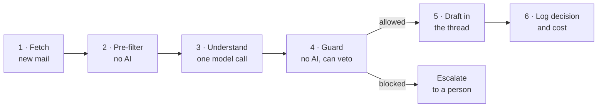

# AI email agent

**Drafts replies to a venue's guest inbox for about £1 a month. A human always presses send.**

- Writes draft replies; it has never sent an email and can't
- A rule layer with no AI can veto any draft
- Anything uncertain goes to a person

> Source is private (live business system). **[Full write-up →](https://sajjad.omni-genai.com/projects/ai-email-agent)**

`Python` · `Microsoft Graph` · `LLM (provider-agnostic)` · `SQLite` · `launchd`

<b>How it works: every ten minutes</b>

Two of the six stages contain no AI at all. The model proposes; ordinary code decides what's allowed out.

<b>The guard layer</b>

- **No bank details, ever:** every draft is scanned for account numbers and IBANs, because invoice fraud targets hospitality inboxes.
- **Price whitelist:** any price in a draft must already be in the knowledge base.
- **Forced escalation:** refunds, chargebacks, solicitors, allergies and similar topics always go to a person.
- **Other rules:** link whitelist, competitor block, length limit, and no draft that says it's automated.
- **Confidence floor:** anything below 0.75 confidence is escalated.
- **Nothing hidden:** a blocked draft is logged and escalated, not silently dropped.

<b>What I built</b>

- Analysed 2,409 exported emails to see what guests actually ask.
- A pre-filter that drops booking platforms, suppliers, marketing and no-reply mail before any AI cost.
- An editable knowledge base per venue, read fresh on every run, so changing a price needs no redeploy.
- Runs on Python's standard library alone, scheduled with launchd.

<b>What the email analysis found</b>

- 21 of 150 sampled guest threads had booked but never received a confirmation.
- 14% of guest mail was caused by one unrelated bug.

---

Built by **[Sajjad Mahessar](https://sajjad.omni-genai.com)** · [LinkedIn](https://www.linkedin.com/in/sajjadmahessar/)
